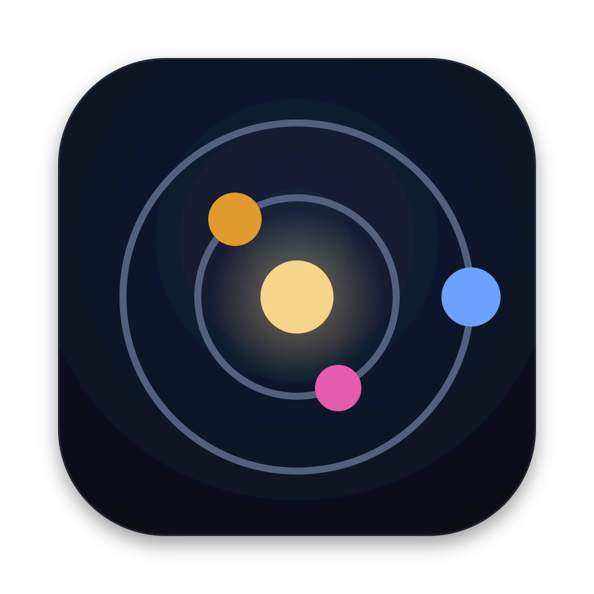
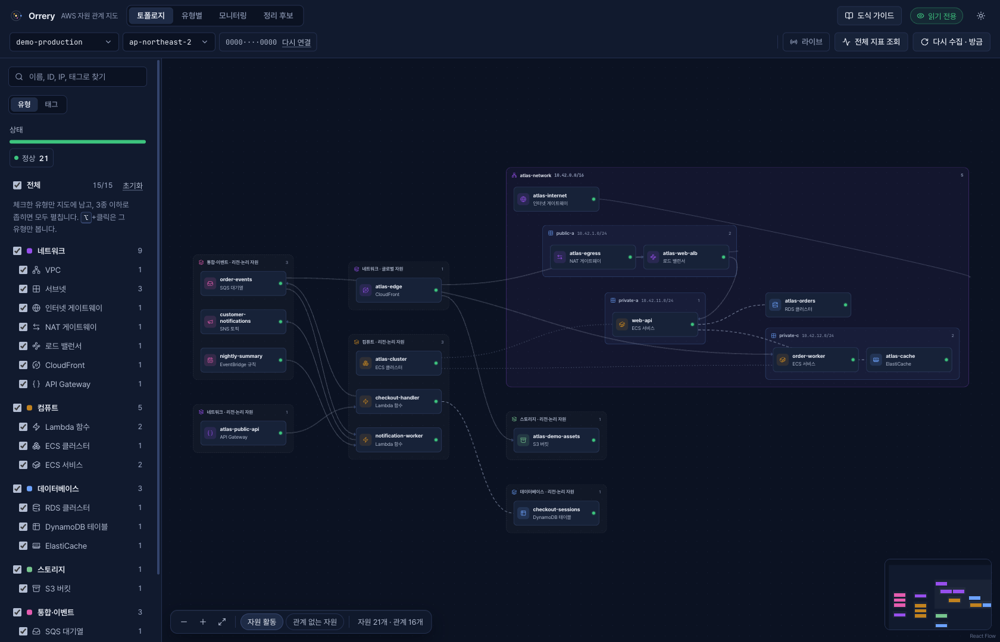
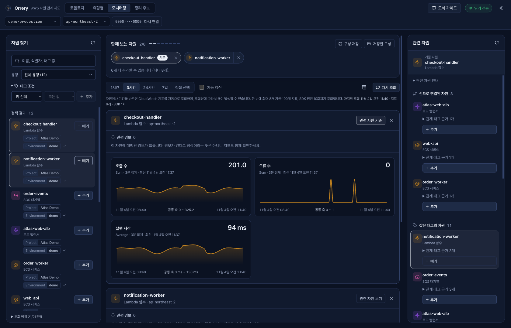

[English](README.md) · **한국어**

  

<h1 align="center">Orrery</h1>

<strong>AWS 자원과 연결을 한눈에.</strong>

내 AWS 프로필로 자원의 위치와 관계를 살펴보고, 상태와 CloudWatch 지표를 함께 확인하는 데스크톱 앱입니다.

  <a href="https://github.com/jjsslee/orrery/releases/latest">다운로드</a> ·
  <a href="#첫-지도-열기">시작하기</a> ·
  <a href="https://github.com/jjsslee/orrery/issues">문제 제보</a> ·
  <a href="docs/README.md">도움말</a>

*현재 앱을 예시 자원으로 촬영한 화면입니다. 상단 언어 선택에서 한국어와 English를 바꿀 수 있으며, 선택은 이 기기에 저장됩니다.*

앱 화면·데스크톱 메뉴·업데이트 안내를 **한국어와 영어**로 제공합니다. 언어를 바꿔도 현재 화면·필터·선택 자원을 유지합니다. AWS 자원 이름·태그·AWS에서 받은 원문 메시지는 그대로 표시합니다.

## 자원 목록에서, 연결의 맥락으로

AWS 자원 하나만 봐서는 전체 구성이 잘 보이지 않습니다. Orrery는 자원의 위치와 연결, 관측 정보를 한 화면에 모아 필요한 자원을 찾고 주변 맥락을 따라갈 수 있게 돕습니다.

| 궁금한 점 | Orrery에서 확인할 수 있는 것 |
|---|---|
| 이 자원은 어디에 있나요? | VPC·서브넷·리전 서비스의 위치와 관계 지도 |
| 무엇과 연결되어 있나요? | 상류·하류 연결, 설정 참조, 태그와 상세 정보 |
| 무엇이 바뀌었거나 주의가 필요한가요? | 관측한 상태, 연결된 경보, 구성 관계의 변화 기록 |
| 관련 자원은 어떻게 동작하고 있나요? | 선택한 최대 8개 자원의 같은 기간 CloudWatch 차트 |
| 정리를 검토할 자원이 있나요? | 미연결 EBS 등의 후보와 판단 근거·불확실성 |

**읽기 전용으로 동작합니다.** AWS 자원을 생성·수정·삭제하지 않습니다. 정리 후보도 검토를 돕는 정보이며, 앱에서 자원을 삭제하지 않습니다.

## 다운로드

[최신 릴리즈](https://github.com/jjsslee/orrery/releases/latest)에서 내 컴퓨터에 맞는 ZIP을 선택하세요.

| 환경 | 다운로드 |
|---|---|
| macOS · Apple Silicon | [Orrery-macos-arm64.zip](https://github.com/jjsslee/orrery/releases/latest/download/Orrery-macos-arm64.zip) |
| macOS · Intel | [Orrery-macos-x64.zip](https://github.com/jjsslee/orrery/releases/latest/download/Orrery-macos-x64.zip) |
| Windows · x64 | [Orrery-windows-x64.zip](https://github.com/jjsslee/orrery/releases/latest/download/Orrery-windows-x64.zip) |

**Mac:** ZIP을 풀고 `Orrery.app`을 응용 프로그램 폴더로 옮겨 실행하세요. **Windows:** ZIP 전체를 풀고 `Orrery/Orrery.exe`를 실행하세요. 함께 들어 있는 파일도 같은 폴더에 있어야 합니다.

Apple Developer ID 서명·공증과 Windows 게시자 서명을 적용하지 않아 보안 경고가 나타날 수 있습니다. Mac은 [Apple의 앱 열기 안내](https://support.apple.com/ko-kr/102445)를 확인하세요. 회사 보안 정책에 따라 실행이 차단될 수 있습니다.

## 첫 지도 열기

1. **AWS 프로필을 준비합니다.** 필요한 조회 권한을 부여한 로컬 프로필을 사용하세요. IAM Identity Center/SSO는 [AWS CLI v2 안내](https://docs.aws.amazon.com/cli/latest/userguide/cli-configure-sso.html)에 따라 설정하고 로그인합니다.
2. **Orrery에서 프로필과 리전을 선택합니다.** 프로필이 없으면 앱이 설정 방법을 안내합니다. SSO 프로필은 **브라우저에서 로그인**으로 연결할 수 있습니다.
3. **확인할 자원을 찾습니다.** 이름 검색과 유형·상태·태그 필터로 범위를 좁힌 뒤, 노드를 선택해 상세 정보와 연결을 확인합니다.
4. **관련 자원을 함께 살펴봅니다.** **모니터링**에서 자원을 선택하고 지원하는 지표와 연결된 경보를 같은 기간으로 비교합니다.

Orrery 계정이나 별도의 서버 가입은 필요 없습니다. AWS 자격증명은 내 컴퓨터에서 읽어 AWS에 직접 인증하며, 자원 정보와 설정은 로컬에 저장합니다. 자세한 경계는 [보안·저장 방식](docs/security.md)과 [사용 가이드](docs/usage.ko.md)를 참고하세요.

## 관련 신호를 같은 화면에

*자원을 선택해 지표 흐름과 경보를 함께 확인합니다. 이미지의 수치는 실제 운영 데이터가 아닌 예시입니다.*

모니터링은 직접 선택한 자원에서 시작합니다. 서비스에 맞는 지표를 같은 기간으로 비교하고, 누락·부분 조회를 구분하며, 선택한 구성을 저장해 다시 볼 수 있습니다. 자동 갱신은 선택 사항이며 모니터링 화면이 보일 때 동작합니다.

**읽기 전용 조회라도 CloudWatch 비용이 발생할 수 있습니다.** 조회할 자원과 기간을 먼저 확인하세요. 앱의 요청 제한이 AWS 비용 상한을 보장하지는 않습니다.

## 매번 다시 설치하지 않아도

**v0.10.0부터** 앱을 사용하는 동안 새 정식 릴리즈를 확인합니다. **업데이트**를 선택하면 다운로드·검증 후 앱을 교체하고 다시 실행하며, **나중에**를 선택하면 현재 버전을 계속 사용합니다. **업데이트 → 업데이트 확인…** 메뉴에서 바로 확인할 수도 있습니다. Windows는 `Alt`로 메뉴를 표시합니다.

새 앱을 시작하지 못하면 이전 버전 복구를 시도합니다. 설치 위치에 쓰기 권한이 있어야 하며, OS 보안 정책에 따라 업데이트나 복구가 차단될 수 있습니다. **v0.10.0 이전 사용자는 이 기능이 포함된 버전을 한 번 수동 설치**해야 합니다.

## 사용 전에 알아둘 범위

- 한 번에 선택한 계정·리전을 봅니다. 지원 서비스와 경보 연결에는 범위가 있으며, 모든 AWS 서비스를 자동으로 다루거나 24시간 장애를 감시하는 서비스는 아닙니다.
- 관계선은 수집한 구성 정보입니다. 실제 통신 성공·접근 허용이나 장애 원인을 증명하지 않습니다.
- 권한 부족·부분 수집·지표 없음은 정상 상태나 미사용 자원과 구분합니다.
- 자원 정보는 로컬에 평문으로 캐시합니다. 장치 접근을 보호하고 필요한 권한으로 범위를 좁힌 AWS 프로필을 사용하세요.
- Windows 실환경의 업데이트·복구와 실제 릴리즈 간 업데이트는 추가 검증이 필요합니다. 버전별 확인 범위는 [릴리즈 노트](https://github.com/jjsslee/orrery/releases)를 참고하세요.

## 질문이나 개선 의견이 있나요?

[GitHub Issues](https://github.com/jjsslee/orrery/issues)에 앱 버전, OS·CPU, 기대한 동작과 예시를 알려주세요. 자격증명·실제 계정 목록·내부 인프라 정보는 제외해 주세요.

[상세 사용 안내와 프로젝트 문서](docs/README.md) · [릴리즈 이력](https://github.com/jjsslee/orrery/releases)
