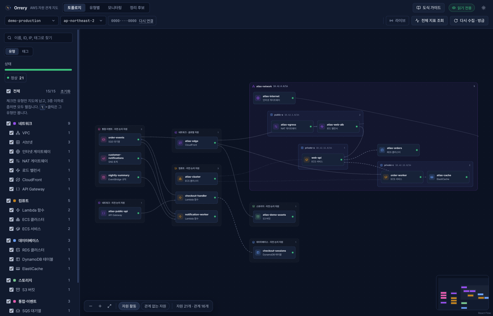
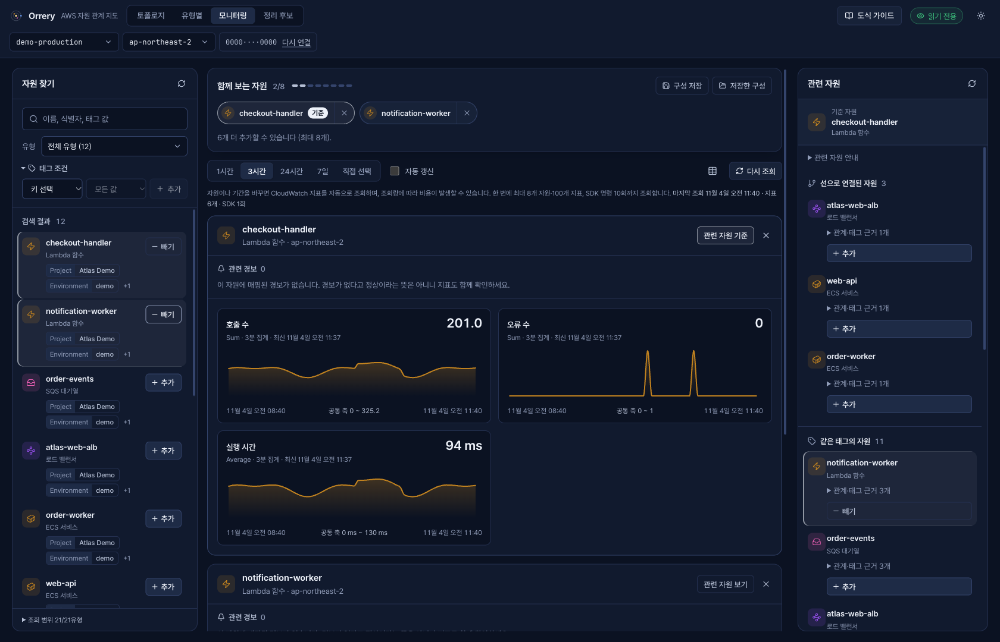

**English** · [한국어](README.ko.md)

  

<h1 align="center">Orrery</h1>

<strong>See how your AWS resources fit together.</strong>

An AWS resource map for your desktop. Explore relationships, inspect health, and compare CloudWatch metrics using your own AWS profile.

  <a href="https://github.com/jjsslee/orrery/releases/latest">Download</a> ·
  <a href="#your-first-map">Get started</a> ·
  <a href="https://github.com/jjsslee/orrery/issues">Report an issue</a> ·
  <a href="docs/README.md">Documentation</a>

*The current app interface, shown with fictional demo resources. Choose English or 한국어 from the language selector in the top bar. Your choice is saved on this device.*

The app, its desktop menus, and update prompts support **English and Korean**. Switching languages keeps your current view, filters, and selected resources. AWS resource names, tags, and original AWS messages remain as provided.

## From inventory to understanding

AWS resources rarely tell the whole story on their own. Orrery brings their placement, connections, and observations into one view so you can find a resource and follow its context.

| What you want to know | What Orrery provides |
|---|---|
| Where does this resource belong? | A map of VPCs, subnets, regional services, and their relationships |
| What is connected to it? | Upstream/downstream links, configuration references, tags, and resource details |
| What changed or needs attention? | Observed state, mapped alarms, and configuration relationship history |
| How are related resources behaving? | CloudWatch charts for up to eight selected resources on a shared time range |
| What might be worth reviewing? | Cleanup candidates such as unattached EBS volumes, with evidence and uncertainty |

**Read-only by design.** Orrery does not create, modify, or delete AWS resources. Cleanup views help you review candidates; they do not remove them.

## Download

Choose the ZIP for your computer from the [latest release](https://github.com/jjsslee/orrery/releases/latest).

| Platform | Download |
|---|---|
| macOS · Apple Silicon | [Orrery-macos-arm64.zip](https://github.com/jjsslee/orrery/releases/latest/download/Orrery-macos-arm64.zip) |
| macOS · Intel | [Orrery-macos-x64.zip](https://github.com/jjsslee/orrery/releases/latest/download/Orrery-macos-x64.zip) |
| Windows · x64 | [Orrery-windows-x64.zip](https://github.com/jjsslee/orrery/releases/latest/download/Orrery-windows-x64.zip) |

**Mac:** extract the ZIP, move `Orrery.app` to Applications, then open it. **Windows:** extract the entire ZIP and open `Orrery/Orrery.exe`; keep its accompanying files together.

These builds do not use Apple Developer ID/notarization or Windows publisher signing, so your OS may show a security warning. On Mac, review [Apple's opening guidance](https://support.apple.com/en-gb/102445). Organization security policies may prevent the app from running.

## Your first map

1. **Have an AWS profile ready.** Use an existing local profile with the read permissions you intend to grant. For IAM Identity Center/SSO, set up and sign in through [AWS CLI v2](https://docs.aws.amazon.com/cli/latest/userguide/cli-configure-sso.html).
2. **Open Orrery and choose a profile and region.** If there are no profiles, the app guides you through setup. SSO profiles can sign in using **브라우저에서 로그인** (“Sign in in browser”).
3. **Find a resource.** Search by name, narrow by type/status/tag, then select a node to inspect its details and connections.
4. **Follow the question.** Use **모니터링** (“Monitoring”) to select resources, compare supported metrics, and inspect their mapped alarms.

No Orrery account or hosted backend is required. AWS credentials are resolved on your computer and used to authenticate directly to AWS. Resource metadata and settings are cached locally; see [security and privacy](docs/security.md).

## Keep related signals together

*Select resources, compare trends, and keep alarm context nearby. All values in this screenshot are synthetic demonstration data.*

Monitoring starts with the resources you choose. Compare supported service metrics over a common time range, inspect missing or partial results, and save a selection for later. Optional automatic refresh runs while the monitoring view is visible.

**AWS charges can apply to metric queries even though they are read-only.** Review the selected resources and time range before querying. Orrery's request limits do not guarantee an AWS cost ceiling.

## Updates without reinstalling every time

Starting with **v0.10.0**, Orrery checks for newer stable releases while it is open. Choose **업데이트** (“Update”) to download, verify, replace, and restart the app, or **나중에** (“Later”) to keep using the current version. The **업데이트 → 업데이트 확인…** menu checks immediately; on Windows, press `Alt` to show the menu.

If the new app does not start successfully, Orrery attempts to restore the previous version. A writable installation location is required, and OS security policies can block an update or recovery. **Versions before v0.10.0 need one manual installation** to receive this feature.

## Know the boundaries

- Work with one selected account and region at a time. Service coverage and alarm mapping are bounded; this is not an all-services AWS inventory or a 24/7 incident service.
- Relationships describe collected configuration, not proof that traffic is flowing, access is allowed, or one resource caused another's failure.
- Missing permissions, incomplete collection, and missing metric data remain distinct from a healthy or unused resource.
- Cached infrastructure metadata is stored locally in plaintext. Protect your device and use an appropriately scoped AWS profile.
- Native Windows update/recovery and real release-to-release upgrades still need real-device validation. See each [release's notes](https://github.com/jjsslee/orrery/releases) for its tested scope.

## Questions or feedback?

Open an [issue](https://github.com/jjsslee/orrery/issues) with your app version, OS/CPU, expected behavior, and a sanitized example. Please leave out credentials, account inventories, and private infrastructure details.

[Detailed guides and project documentation](docs/README.md) · [Release history](https://github.com/jjsslee/orrery/releases)
