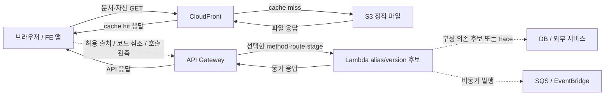

# URL 하나로 AWS 요청 경로를 설명하기

**사용자가 URL만 입력해도 FE 호스팅 경로와 BE 연결 후보, API에서 Lambda까지의 경로를 자동으로 보여주는 기능은 구현할 수 있다. 가장 먼저 활용할 단서는 CORS다.** HTTP API의 CORS는 현재 Orrery가 호출하는 `GetApis` 응답에 이미 포함될 수 있지만 저장하지 않고 있다. 이를 CloudFront 대체 도메인과 매칭하면 추가 관계 입력 없이 “이 FE를 허용하는 API”를 찾을 수 있다. 다만 설정상 허용, 코드에서 참조, 로그에서 관측, 특정 요청의 trace는 서로 다른 사실이다. 제품은 이 근거를 구분하면서 URL의 **조건부 요청·응답 경로**를 설명해야 한다. 캐시 상태, 인증, 실행 코드, 사용자 행동까지 모르는 상태에서 모든 실제 호출이나 응답 시간을 완벽히 예측하는 기능으로 약속해서는 안 된다.

조사 기준일은 **2026-10-26, Asia/Seoul**이다. 현재 Orrery 소스와 공식 AWS·브라우저·프레임워크 문서를 대조했다. 아래 구현안은 제안이며, 실계정 조회·실제 URL 호출·운영 설정 변경·구현·테스트는 수행하지 않았다. 실제 자동 연결률, 계정별 권한, 과금액은 미확인이다.

## 1. CORS부터 읽으면 FE와 BE를 자동으로 연결할 수 있다

### 이미 받는 데이터부터 살리는 것이 첫 작업이다

HTTP API는 `CorsConfiguration.AllowOrigins`에 허용 출처를 둔다. 예를 들어 `https://app.example.com`이 들어 있고 같은 호스트가 CloudFront의 alias라면, 해당 배포가 제공하는 FE와 API를 **허용 출처 관계**로 자동 연결한다. 이어 API의 integration에서 Lambda를 찾는다. 현재 코드는 `GetApis`를 호출하지만 API 노드로 옮길 때 CORS를 버린다. 추가 API 호출 없이 수집 로직을 개선할 수 있지만, 이미 저장한 그래프에는 값이 없으므로 **개선 후 재수집**은 필요하다. ([GetApis 응답](https://docs.aws.amazon.com/apigatewayv2/latest/api-reference/apis.html), [현재 조회 위치](/Users/jin/Repos/orrery/server/src/collectors/edge.ts:197), [현재 노드 생성](/Users/jin/Repos/orrery/server/src/collectors/edge.ts:233))

| CORS 위치 | 얻을 데이터 | 현재 Orrery에서 필요한 일 | 의미와 한계 |
|---|---|---|---|
| API Gateway HTTP API | `CorsConfiguration.AllowOrigins`, methods, headers, credentials | 이미 받는 응답을 구조화해 보존 | 구체 origin이면 FE 자동 매칭 가능. 실제 호출 여부는 별개 |
| REST API non-proxy/OPTIONS | integration response의 `Access-Control-Allow-Origin` 등 | 기존 embedded integration 또는 `GetIntegration` 응답에서 정적 값 추출 | method/path/status별 범위 보존. 동적 mapping은 미확인 |
| REST API Lambda proxy | Lambda가 만드는 응답 헤더 | 설정만으로 없을 수 있음. 의미 있는 env·배포 코드·기존 로그로 보강 | 일반 Lambda에 중앙 CORS 목록이 있는 것은 아님 |
| Lambda Function URL | Function URL의 `Cors`, URL, qualifier, auth, invoke mode | `ListFunctionUrlConfigs`/`GetFunctionUrlConfig` 추가 | API Gateway 없는 직접 Lambda 호출도 연결 가능 |
| 동일 origin의 `/api/*` | CloudFront behavior와 API origin | 경로별 설정 보존·평가 | CORS 없이도 동작하므로 CORS 부재는 관계 부재가 아님 |

HTTP API에 CORS를 구성하면 API Gateway가 preflight에 응답하고 backend CORS 헤더보다 해당 구성을 적용한다. REST API는 OPTIONS MOCK/non-proxy 응답 설정과 proxy backend 응답 처리가 구분된다. Function URL은 별도의 CORS 설정을 제공한다. 따라서 세 유형을 같은 수집 방식으로 취급하면 안 된다. ([HTTP API CORS](https://docs.aws.amazon.com/apigateway/latest/developerguide/http-api-cors.html), [REST API CORS](https://docs.aws.amazon.com/apigateway/latest/developerguide/how-to-cors.html), [Function URL CORS](https://docs.aws.amazon.com/lambda/latest/api/API_Cors.html))

현재 REST 수집기의 `consume()`은 integration type과 URI를 사용하고 `integrationResponses.responseParameters`는 보존하지 않는다. OPTIONS도 기존 method loop에 포함되므로 고정 문자열 허용 origin은 재활용할 수 있다. 다만 현재 조회는 stage 배포본이 아닌 편집 구성일 수 있다는 제한이 있다. Lambda 수집기에는 Function URL 조회 자체가 없다. ([REST integration 처리](/Users/jin/Repos/orrery/server/src/collectors/edge.ts:136), [method 순회](/Users/jin/Repos/orrery/server/src/collectors/edge.ts:144), [Lambda 수집 API](/Users/jin/Repos/orrery/server/src/collectors/lambda.ts:8))

### CORS 매칭은 정확한 origin과 관계 종류를 보존해야 한다

제안하는 매칭 키는 `scheme + normalized host + effective port`다. CloudFront alias로 호스팅 자원을 찾되, CORS 비교에서는 scheme과 port를 버리지 않는다. `*`, `https://*`, `http://*`, `null`을 계정의 모든 FE와 연결하지 않는다. 허용 목록의 localhost·과거 도메인·외부 파트너도 현재 운영 FE로 단정하지 않는다. 여러 origin이면 여러 허용 관계를 만들되 실제 호출 목록과 분리한다.

`ALLOWED_ORIGINS`와 `API_BASE_URL`은 값이 URL이어도 의미가 다르다. 현재 Lambda 수집은 `Object.values()`로 환경 변수 이름을 버려 이 구분이 사라진다. 의미를 서버 메모리에서 분류한 다음 필요한 origin과 근거만 보존하는 것이 적절하다. `Environment=prod` 같은 공통 태그나 비슷한 이름은 후보 순서를 보조하는 데만 쓰고 호출선 생성 근거로 쓰지 않는다. CloudFront alias도 현재 표시용 속성에는 있지만 DNS 인덱스가 충분히 활용하지 못한다. ([환경 변수 처리](/Users/jin/Repos/orrery/server/src/collectors/lambda.ts:49), [도메인 인덱스](/Users/jin/Repos/orrery/server/src/graph/assemble.ts:85), [태그 후보](/Users/jin/Repos/orrery/server/src/monitoring/related.ts:30))

**CORS는 권한 인증도, 실제 사용 실적도 아니다.** UI에는 `허용 출처 설정`이라고 표시해야 한다. 또한 preflight가 필요한 요청과 단순 요청을 구분해야 한다. 브라우저에서 CORS 응답 접근이 차단됐다고 서버가 요청을 처리하지 않았다는 뜻은 아니므로, “CORS 실패 → Lambda 미실행”으로 일괄 시뮬레이션하면 안 된다. ([REST CORS의 simple/non-simple 구분](https://docs.aws.amazon.com/apigateway/latest/developerguide/how-to-cors.html))

### CORS로 부족한 곳은 정적 참조와 기존 관측으로 보강한다

기본 발견 순서는 **CORS·도메인·동일 origin 라우팅 → 배포 파일 참조 → 기존 API 측 로그 → 기존 trace**를 권장한다. 다만 이미 잘 연결된 로그가 있다면 파일 읽기보다 먼저 사용할 수 있다. 어느 단계에서도 사용자가 관계를 하나씩 입력하거나 승인하게 만들 필요는 없다. 근거가 부족한 후보를 접어 두거나 `미확인`으로 남기면 된다.

| 근거 종류 | 얻는 사실 | 자동 처리 | 단정하면 안 되는 사실 |
|---|---|---|---|
| `routing_config` | 특정 조건에서 설정된 전달 대상 | AWS routing 설정 해석 | 이번 요청이 실제 도달함 |
| `allowed_origin` | 특정 FE origin을 허용하는 설정 | CORS와 FE domain 매칭 | FE 코드가 그 API를 사용함 |
| `static_reference` | 배포 파일이 API를 참조함 | HTML/JS/runtime config 제한 분석 | 모든 코드 분기가 실행됨 |
| `observed` / log | 일정 기간 특정 origin을 주장하는 요청 관측 | API 측 Origin/Referer 추출 | 신뢰할 수 있는 사용자 인증·완전한 trace |
| `observed` / trace | 해당 trace에서 연결된 호출·span | trace parent/integration ID 매칭 | 미계측·미샘플링 구간까지 모두 존재 |
| `heuristic` | 같은 서비스일 가능성 | 태그·이름·도메인 보조 매칭 | 호출 관계 확정 |
| `manual` | 사용자가 제공한 운영 지식 | 선택적 보완 | 자동 발견에 필수인 절차 |

배포된 FE의 HTML이 참조하는 JS와 명시된 runtime config에서 API 주소를 찾을 수 있다. Vite의 공개 env와 Next.js `NEXT_PUBLIC_*`는 빌드 때 번들에 들어갈 수 있어서, 현재 서버 env보다 실제 배포 파일이 더 직접적인 단서가 된다. 그러나 정규식 URL 검색은 후보 추출일 뿐이다. 주석·미사용 코드·분석 SDK 주소를 걸러야 하고, 명확한 literal 호출과 설정 연결을 우선한다. 동적 tenant 주소·로그인 뒤 config·lazy load·SSR/BFF 내부 호출은 추가 근거 없이 완전히 복원할 수 없다. ([Vite env](https://vite.dev/guide/env-and-mode), [Next.js env](https://nextjs.org/docs/pages/guides/environment-variables))

기본 정적 분석은 JS를 실행하지 않는다. S3 객체 읽기와 공개 HTTP fetch도 서로 다른 모드다. S3의 최신 파일이 CloudFront 캐시에 남은 제공 버전과 다를 수 있으므로 ETag·version·수집 시각을 남긴다. `.env` 탐색, Secrets Manager 값 읽기, 버킷 전체 크롤링은 이 기능에 필요하지 않다.

## 2. URL은 하나의 직선이 아니라 조건별 요청 묶음으로 풀어야 한다

### 사용자에게 보여줄 것은 문서 요청과 API 요청의 연결이다

FE를 내려받는 요청과 FE 코드가 시작하는 API 요청은 별개다. S3가 API Gateway를 호출하는 것으로 그리면 잘못된 경로다. FE를 논리 노드로 두고, AWS 자원은 호스팅·라우팅·통합 관계로 연결한다. 아래 그림은 일반적인 구성 설명이며 실제 요청 관측을 뜻하지 않는다.

입력 URL은 기본 `GET`으로 분석하고 화면에 그 가정을 표시한다. API URL임을 알더라도 method를 모르면 가능한 route를 보여준다. 고급 조건은 method, 비민감 routing header, public/private 위치, cache hit/miss/unknown 정도로 제한한다. 토큰·쿠키·body는 기본 입력에서 제외한다. URL fragment는 서버로 보내는 경로와 분리하되 SPA 화면 단서로 보존한다. host는 정규화하지만 path는 서비스별 규칙에 맞춰 처리하고 일괄 decode하지 않는다.

DNS는 사전 이름 해석이다. VPC·subnet은 배치, SG·IAM·KMS는 접근·암호화 조건이다. 모두 HTTP 요청이 순서대로 통과하는 서버처럼 그리지 않는다. Lambda에 DB endpoint가 있다는 이유로 모든 API 호출이 DB를 방문한다고 표시하지도 않는다. 해당 요청의 downstream 실행은 trace나 명확한 호출 로그가 필요하다.

### 서비스별 라우팅 규칙을 원형에 가깝게 보존해야 한다

| 구간 | 필요한 읽기 데이터/API | 해석해야 하는 조건 |
|---|---|---|
| DNS | Route 53 `ListHostedZones`, `ListResourceRecordSets`; record별 이름·alias/CNAME·routing policy | weighted·latency·failover 등은 위치/health에 따라 후보가 달라짐. 외부 DNS는 경계로 표시 |
| CloudFront | `ListDistributions`, 대상 `GetDistribution`/`GetDistributionConfig` | aliases, default root, **ordered** behaviors, target origin, origin path/groups, custom error, function associations, 배포 상태 |
| CloudFront 정책 | `GetCachePolicy`, `GetOriginRequestPolicy`, `GetResponseHeadersPolicy` | cache key와 origin에 전달되는 header/query/cookie를 분리 |
| S3 | `GetBucketWebsite`, 필요한 경우 대상 `HeadObject`/`GetObject` | website redirect와 REST origin, SPA fallback, 실제 object key |
| API custom domain | REST `GetDomainNames`/`GetBasePathMappings`, V2 `GetDomainNames`/`GetApiMappings`, `ListRoutingRules` | mapping prefix, routing mode·priority·header/base-path 조건·strip path |
| REST API | `GetStage(s)`, stage `GetExport`와 integration extensions; 필요시 `GetResources`, `GetMethod`, `GetIntegration`, `GetAuthorizers`, `GetVpcLinks` | 배포 stage, method/path, variables/canary, auth, integration URI, response mapping |
| HTTP API | `GetApis`, `GetStages`, `ExportApi(StageName, IncludeExtensions)`, `GetRoutes`, `GetIntegrations`, authorizers/VPC links | route→integration 대응, CORS, auto-deploy/deployment, request mapping |
| Function URL | `ListFunctionUrlConfigs`/`GetFunctionUrlConfig`, `GetAlias`, 필요시 qualified function config/policy | URL·CORS·auth·alias/version·buffered/streaming |
| ALB | `DescribeListeners`, `DescribeRules`, `DescribeTargetGroups`, `DescribeTargetHealth`, attributes | priority, host/path/method/header/query 조건, auth, redirect/fixed response, weighted forward, transforms |
| ECS/EC2 | target inventory와 task/ENI 정보 | target IP의 특정 시점 task 매칭. 서비스 관계만으로 이번 task를 단정하지 않음 |
| WAF | `GetWebACL` 및 연관 rule/association 정보 | 검사 위치를 표시. 입력·동적 상태 부족이면 allow/block 판정은 미확인 |
| Lambda 후속 처리 | alias, event source mappings, async config/destinations, 기존 trace | 동기 호출, 비동기 enqueue, 큐 consumer, retries를 구분 |

CloudFront는 가장 구체적인 pattern이 아니라 **설정 순서상 처음 일치한 behavior**를 사용한다. API mapping은 longest matching prefix, HTTP API route는 구체적 route·greedy·default 우선순위를 따르며, ALB는 rule priority와 조건을 평가한다. 범용 “문자열에 포함되면 연결”로 통합할 수 없다. ([CloudFront behaviors](https://docs.aws.amazon.com/AmazonCloudFront/latest/DeveloperGuide/DownloadDistValuesCacheBehavior.html), [API mapping](https://docs.aws.amazon.com/apigateway/latest/developerguide/http-api-mappings.html), [HTTP routes](https://docs.aws.amazon.com/apigateway/latest/developerguide/http-api-develop-routes.html), [ALB rules](https://docs.aws.amazon.com/elasticloadbalancing/latest/application/listener-rules.html))

**실제 배포본과 편집 중 설정을 구분해야 한다.** REST는 stage export를 우선하고, HTTP `ExportApi`에는 `StageName`을 지정한다. stage 없이 얻은 최신 설정을 운영 경로로 위장하지 않는다. export가 실패하거나 표현하지 못하는 설정이 있으면 별도 조회로 보완하고 coverage에 남긴다. CloudFront도 배포 중 상태라면 새 설정이 모든 edge에 적용됐다고 단정하지 않는다. ([REST export](https://docs.aws.amazon.com/apigateway/latest/developerguide/api-gateway-export-api.html), [HTTP ExportApi](https://docs.aws.amazon.com/cli/latest/reference/apigatewayv2/export-api.html))

최근 AWS 기능도 경계에 포함해야 한다. REST custom domain은 단순 base-path mapping뿐 아니라 header/base-path RoutingRules를 지원한다. CloudFront Functions는 URI만 바꾸는 경우와 origin helper로 전달 origin을 바꾸는 경우가 다르다. ALB에도 host/URL rewrite transforms가 있다. 초기 엔진이 이를 지원하지 않으면 해당 단계에서 `동적 규칙 미해석`으로 남겨야 한다. 원격 function 코드를 임의 실행해서 해결하지 않는다. ([REST RoutingRules](https://docs.aws.amazon.com/apigateway/latest/developerguide/rest-api-routing-rules.html), [CloudFront origin helpers](https://docs.aws.amazon.com/AmazonCloudFront/latest/DeveloperGuide/helper-functions-origin-modification.html), [ALB listener rules](https://docs.aws.amazon.com/elasticloadbalancing/latest/application/listener-rules.html))

### 응답과 실패 경로도 조건부로 표현한다

CloudFront cache hit이면 S3나 API origin에 가지 않는다. origin failover도 모든 method에 적용되는 것이 아니며 지정 조건에서 GET·HEAD·OPTIONS에 적용된다. Lambda weighted alias나 ALB weighted target이면 특정 version/target을 임의로 선택하지 않는다. DNS 정책도 입력자의 위치·health에 따라 달라질 수 있다. ([CloudFront failover](https://docs.aws.amazon.com/AmazonCloudFront/latest/DeveloperGuide/high_availability_origin_failover.html), [Lambda alias routing](https://docs.aws.amazon.com/lambda/latest/dg/configuring-alias-routing.html), [Route 53 정책](https://docs.aws.amazon.com/Route53/latest/DeveloperGuide/routing-policy.html))

동기 응답은 선택된 호출 chain을 따라 되돌아가지만, redirect는 브라우저의 새 요청이고 async enqueue는 먼저 응답한 뒤 후속 실행이 이어진다. streaming은 응답 완료 이전에 일부 데이터를 보낼 수 있다. SQS consumer의 처리 결과를 최초 HTTP 응답처럼 붙이면 안 된다. ([Lambda async](https://docs.aws.amazon.com/lambda/latest/dg/invocation-async.html), [response streaming](https://docs.aws.amazon.com/lambda/latest/dg/configuration-response-streaming.html))

설정 분석으로 확정할 수 있는 route 선택과 인증/WAF/실행 결과는 분리한다. UI는 `cache hit이면 여기서 응답`, `이 헤더가 있으면 다른 API`, `인증 결과 미확인`, `호출 가능한 Lambda 후보`처럼 조건을 설명한다. 재생 애니메이션은 설명용이며 실제 duration을 만들어내지 않는다. CloudWatch 평균 latency도 특정 요청의 소요 시간으로 사용하지 않는다.

## 3. 기존 로그와 trace는 자동 연결을 보강하지만 완전성을 보장하지 않는다

### Referer와 Origin은 API 요청이 실제로 지나간 위치에서 찾는다

| 데이터 | FE 출처 발견 | 경로·응답 분석 가치 | 주요 제한 |
|---|---|---|---|
| API Gateway Access Log | 기본 지원 변수에 임의 원본 Referer/Origin accessor 없음 | API/stage/path/status/request ID | `domainName`은 API 대상 Host이지 FE 주소가 아님 |
| REST Execution Log | 기존 설정·로그 형식에 헤더가 남으면 가능 | integration 처리·오류·요청 흐름 | level/data tracing·redaction·잘림 확인 필요 |
| HTTP API Execution Log | REST와 같은 기능 없음 | backend/앞단 로그로 보완 | REST 지원을 HTTP에 일반화하면 안 됨 |
| Lambda 로그 | 앱이 이미 헤더를 기록한 경우 | request ID·앱 오류·선별 호출 | START/END/REPORT만으로 헤더를 알 수 없음 |
| **API 앞** CloudFront 로그 | `cs(Referer)`/`cs-referer` | cache·status·요청 경로 | 설정·필드·sampling·전달 지연 영향 |
| WAF 로그 | `httpRequest.headers` | 보호 대상·차단/허용·요청 경로 | redaction·필터·표본 누락 가능 |
| ALB access log | 기본 schema에 일반 Referer/Origin 필드 없음 | target·rule·status·trace ID·rewrite | FE 특정은 다른 근거 필요 |
| 기존 X-Ray/OTel trace | trace context 연결 범위에서 | 특정 요청의 순서·시간·downstream | 계측·sampling·보존 범위 밖은 미확인 |

REST·HTTP API Access Log에서 `$context.requestOverride.header.*` 또는 authorizer context를 원본 요청 헤더 범용 accessor로 오해하면 안 된다. 이미 authorizer가 값을 전달하는 구성은 사용할 수 있지만 새로 넣는 것은 애플리케이션 변경이다. REST execution log에서 INFO를 켰다는 사실만으로 모든 헤더가 반드시 존재한다고도 보장하지 않는다. ([REST Access Log 변수](https://docs.aws.amazon.com/apigateway/latest/developerguide/api-gateway-variables-for-access-logging.html), [HTTP Access Log 변수](https://docs.aws.amazon.com/apigateway/latest/developerguide/http-api-logging-variables.html), [REST execution logging](https://docs.aws.amazon.com/apigateway/latest/developerguide/rest-api-execution-logging.html), [REST/HTTP 차이](https://docs.aws.amazon.com/apigateway/latest/developerguide/http-api-vs-rest.html))

API 측 CloudFront의 Referer나 WAF 헤더에서 FE origin을 추출해 CloudFront alias와 매칭할 수 있다. 그러나 **FE 정적 호스팅 CloudFront는 브라우저가 다른 도메인으로 직접 보낸 API 요청을 보지 못한다.** FE CloudFront 로그만으로 이 연결을 추론해서는 안 된다. ALB의 source IP를 FE IP로 취급하는 것도 잘못이다. 브라우저 직접 호출의 출발 IP는 사용자나 중간 proxy다. ([CloudFront log fields](https://docs.aws.amazon.com/AmazonCloudFront/latest/DeveloperGuide/standard-logs-reference.html), [WAF fields](https://docs.aws.amazon.com/waf/latest/developerguide/logging-fields.html), [ALB access log schema](https://docs.aws.amazon.com/elasticloadbalancing/latest/application/load-balancer-access-logs.html))

로그 자동 발견은 고정 이름만 검색하지 않는다. stage access log destination, REST execution logging/delivery, Lambda LoggingConfig, CloudFront logging delivery, WAF LoggingConfiguration을 확인한다. 최신 REST execution log 문서는 표준 자동 관리 그룹 외 delivery 방식을 설명하고, CloudFront standard v2는 목적지와 필드를 구성한다. ALB도 S3만 가정하면 현재 지원하는 CloudWatch delivery를 놓칠 수 있다. ([REST execution logging](https://docs.aws.amazon.com/apigateway/latest/developerguide/rest-api-execution-logging.html), [CloudFront standard logging](https://docs.aws.amazon.com/AmazonCloudFront/latest/DeveloperGuide/standard-logging.html), [ALB CloudWatch logging](https://docs.aws.amazon.com/elasticloadbalancing/latest/application/load-balancer-cloudwatch-logs.html))

Referer는 정책에 따라 생략되거나 origin만 남고 Origin도 없거나 null일 수 있다. 비브라우저 클라이언트는 값을 위조할 수 있다. 따라서 `기간 내 해당 origin 헤더 관측`으로 표현하고 인증 증거로 쓰지 않는다. OPTIONS만 관측됐는지 실제 API 요청도 있었는지, 성공·차단·오류인지 구분한다. `로그 미설정`, `권한 없음`, `보존 기간 밖`, `표본 없음`, `헤더 없음`, `조회 한도 도달`도 별도 상태여야 한다. ([Referrer Policy](https://w3c.github.io/webappsec-referrer-policy/), [Origin 표준](https://www.rfc-editor.org/rfc/rfc6454.html))

### 특정 한 번의 요청은 상관 ID가 있어야 연결한다

X-Ray는 `GetTraceSummaries`로 ID를 찾고 `BatchGetTraces`로 상세를 읽을 수 있다. 직접 계측한 segment와 caller subsegment로부터 추론한 서비스도 구분해야 한다. Browser request ID, API Gateway request ID, Lambda request ID가 같은 값이라고 가정하지 않는다. 정식 trace parent 관계나 integration ID 대응이 있을 때만 한 요청으로 묶고, 시간·IP·경로가 비슷한 로그는 후보로 남긴다. ([X-Ray 데이터 조회](https://docs.aws.amazon.com/xray/latest/devguide/xray-api-gettingdata.html))

CloudWatch RUM을 쓴다고 자동으로 FE와 BE trace가 이어지는 것도 아니다. 필요한 요청에 trace header를 전파하고 cross-origin CORS에 그 header를 허용해야 한다. 이미 있는 계측은 읽어서 활용하되, 신규 계측을 무입력 MVP의 전제조건으로 두지 않는다. 새 계측이 필요하면 OpenTelemetry를 우선 검토한다. X-Ray SDK/daemon은 2026-02-25 maintenance mode에 들어갔으며, 현재 공식 timeline의 종료일은 N/A다. 이는 X-Ray 서비스 종료를 뜻하지 않는다. ([RUM과 X-Ray](https://docs.aws.amazon.com/xray/latest/devguide/xray-services-RUM.html), [현재 SDK timeline](https://docs.aws.amazon.com/xray/latest/devguide/xray-sdk-daemon-timeline.html))

선택적인 browser/CDP 또는 HAR 모드는 문서·initiator·redirect·preflight·cache/service-worker·응답/실패를 관측할 수 있다. 하지만 첫 페이지 방문 한 번이 로그인 뒤 화면·버튼·tenant·feature flag의 모든 호출을 대변하지 않는다. service worker가 로컬에서 응답하면 AWS 요청이 없을 수도 있다. browser 관측을 위해 cache를 끄거나 service worker를 우회하면 그 조건 변경을 표시한다. ([CDP Network](https://chromedevtools.github.io/devtools-protocol/tot/Network/), [Chrome Network/HAR](https://developer.chrome.com/docs/devtools/network/reference/))

**브라우저 실행은 읽기 전용 AWS 조회와 다르다.** 페이지 로드만으로 analytics·POST·세션 갱신 같은 실제 동작이 발생할 수 있다. 기본 모드는 설정 분석이며, 실제 관측 실행·로그인·자동 클릭·요청 재전송은 별도의 선택 기능이다. 이번 조사에서는 어떤 사이트도 실행하지 않았다.

## 4. 현재 그래프를 재사용하되 경로 엔진과 근거 모델은 분리한다

### 현재 구현에는 필요한 정보가 요약 과정에서 사라진다

| 현재 코드 | 문제 | 최소 변경 방향 |
|---|---|---|
| [CloudFront collector](/Users/jin/Repos/orrery/server/src/collectors/edge.ts:73) | 모든 origin을 refs로 연결하고 behavior별 선택 근거 소실 | aliases·ordered rules·origin path/groups를 별도 보존 |
| [Route 53 collector](/Users/jin/Repos/orrery/server/src/collectors/edge.ts:276) | record와 target 대응을 zone 단위로 집계 | record별 routing snapshot 생성 |
| [REST collector](/Users/jin/Repos/orrery/server/src/collectors/edge.ts:119) | route를 Lambda별 개수로 축약, 배포본·CORS 응답 정보 소실 | method/path/stage/integration/CORS 원형 보존 |
| [HTTP collector](/Users/jin/Repos/orrery/server/src/collectors/edge.ts:192) | CORS를 버리고 `GetRoutes` 미호출 | CORS 재활용, route→integration·stage 상세 조회 |
| [Lambda collector](/Users/jin/Repos/orrery/server/src/collectors/lambda.ts:49) | env 이름 소실, Function URL 미수집 | 의미 분류만 보존, qualifier/URL/CORS 추가 |
| [ALB collector](/Users/jin/Repos/orrery/server/src/collectors/elb.ts:53) | listener actions를 보존하지 않고 rules 미조회 | URL 후보 listener에 한해 rules/targets 상세 조회 |
| [ECS collector](/Users/jin/Repos/orrery/server/src/collectors/ecs.ts:140) | service 관계는 있으나 이번 task/IP 식별 없음 | task/ENI 관측 시점과 scope 추가 |
| [graph assemble](/Users/jin/Repos/orrery/server/src/graph/assemble.ts:41) | 수집 안 된 target의 선 제거, refs 삭제 | path 결과에는 외부·권한 부족·미수집 endpoint 유지 |
| [shared edges](/Users/jin/Repos/orrery/shared/src/index.ts:158) | 구성/추정/관측 provenance 없음 | 기존 지도와 별도 evidence/path 계약 |
| [resource IDs](/Users/jin/Repos/orrery/server/src/collectors/ids.ts:3) | ID에 account/region 없음 | 여러 scope를 합칠 때 ARN 또는 scoped key 사용 |

현재 그래프는 UI용 자원 관계 모델이며 그대로 DFS/BFS를 돌린 결과를 실제 요청 순서로 보여주면 안 된다. 일부 collector 실패나 개별 조회 상한도 최종 전체 성공 여부만으로 충분히 드러나지 않는다. 경로 엔진에는 필드·단계별 `coverage`가 필요하다. ([개별 조회 처리](/Users/jin/Repos/orrery/server/src/collectors/util.ts:23), [REST 보완 조회 상한](/Users/jin/Repos/orrery/server/src/collectors/edge.ts:150))

### 별도 routing snapshot과 request DAG가 최소 설계다

권장 처리 흐름은 `URL 정규화 → 도메인 후보 인덱스 → 필요한 routing 상세 조회 → 조건 평가 → FE API 후보 발견 → 선택적 기존 관측 보강 → 요청·응답 DAG 표시`다. 자격증명·계정 확인·AWS client factory와 기존 자원 UI는 재사용한다. 시뮬레이션 전용 browser/FE 논리 노드는 기존 모든 ResourceType에 억지로 섞지 않고 view model에 둔다. ([기존 세션](/Users/jin/Repos/orrery/server/src/aws/sessions.ts:18), [client factory](/Users/jin/Repos/orrery/server/src/aws/clients.ts:18), [기존 view 상태](/Users/jin/Repos/orrery/web/src/model/store.ts:7))

| 제안 타입 | 필수 필드·역할 |
|---|---|
| `RequestContext` | 안전하게 정규화한 URL, method, 알려진 조건/모르는 조건, scope, 기본 가정 |
| `RoutingSnapshot` | schema version, account/partition/region, ARN, deployment/ETag, 수집 시각, 정규화 규칙, 구간별 coverage |
| `Evidence` | 근거 종류, 출처 API/로그 참조, 시각/기간, 일치 사실, 한계, request/trace 연관 여부 |
| `PathStep` | resource 또는 논리 node, route/cache/auth/invoke/respond/async action, 근거 ID, 조건·미확인 이유 |
| `PathBranch` | 가능한 다음 단계, 선택 조건, 평가 결과 true/false/unknown |
| `SimulationResult` | 문서 경로, 발견된 API별 경로, 응답/비동기 가지, 미확인 구간, freshness, 조회량·잘림 상태 |

구성의 정확성과 실행 관측은 별도 축이다. 예를 들어 `배포 설정 확인 / 이번 실행 미관측`, `최근 관측 있음 / 현재 설정은 10분 전`을 동시에 표현한다. 출처 없는 “정확도 95%”는 쓰지 않는다. 요청 경로를 발견하지 못했을 때도 `없음` 대신 `CORS wildcard`, `외부 계정`, `권한 부족`, `동적 함수 미해석` 등 이유를 남긴다.

UI는 URL 입력 후 문서 경로를 먼저 보여주고, 자동 발견된 API를 근거별로 묶어 선택할 수 있게 한다. 각 API를 선택하면 요청 조건과 응답 가지를 설명한다. 구성상 관계는 설정 근거, CORS 관계는 허용 출처, 관측 관계는 기간·마지막 관측·상태를 표시한다. 사용자가 모든 관계를 승인하는 단계는 두지 않는다.

### 기존 토폴로지에도 다른 선으로 표시할 수 있다

**CORS·코드 참조·관측 근거는 시뮬레이터뿐 아니라 현재 토폴로지에도 표시하는 것이 좋다.** 같은 evidence 모델을 두 화면이 공유하면 URL 탐색에서 발견한 FE–BE 관계를 전체 구조에서도 볼 수 있다. 시뮬레이터는 특정 URL과 조건의 경로를 강조하고, 토폴로지는 여러 서비스의 구성·허용·참조 관계를 함께 보여주는 역할로 구분한다.

| 토폴로지 표현 제안 | 의미 | 표시할 근거 |
|---|---|---|
| 실선 | AWS 설정에 명시된 해당 관계 | CloudFront origin, API integration 등 설정 출처 |
| 긴 점선 | FE origin을 API가 허용 | `CORS 허용`, exact origin, method/path 범위 |
| 짧은 점선 | 배포 코드에서 참조한 후보 | `코드 참조`, 파일/빌드 식별자, 정적 분석 한계 |
| 기존 선의 `관측됨` 배지 | 로그 또는 trace의 추가 근거 | 관측 기간·마지막 시각·관측 종류 |
| 그룹·후보 표시 | 태그·이름상 서비스 연관 | 호출 화살표를 만들지 않음 |
| 미확인 표시 | 기존 관계의 provenance 미분류 | `근거 미분류`, 재수집·분류 필요 |

선 스타일은 제품 제안이며 기존 선을 일괄 실선으로 확정해서는 안 된다. 현재 그래프에는 env 값과 이름에서 추정한 관계도 있으므로 **기존 edge의 근거 분류가 선 스타일 적용의 선행 작업**이다. 실선도 “이번 요청이 반드시 지나갔다”는 뜻이 아니라 “설정에 해당 관계가 명시됐다”는 뜻이다. 관측 배지는 CORS나 설정 근거를 덮어쓰지 않고 함께 보존한다.

FE는 origin으로 식별되는 논리 앱 노드나 그룹으로 표현하고 CloudFront·S3를 호스팅 관계로 묶는다. CORS 선은 그 FE 앱에서 API로 이어야 한다. S3→API 호출선으로 그리면 안 된다. 동일한 FE–API 관계에 CORS·코드·로그 근거가 겹치면 의미상 동일 edge에 근거를 모으고, 클릭했을 때 상세를 펼쳐 선이 중복되지 않게 한다. origin 식별에는 scheme·host·port와 계정/환경 범위를 보존한다.

대표 사용 흐름은 **지도에서 CX FE 선택 → CORS 허용 등 근거가 있는 API 후보 선 표시 → 선 클릭 → 관련 API Gateway와 Lambda를 지도에 펼치기**다. 처음부터 모든 BE를 펼치지 않고 API 후보 끝점을 접힌 노드로 표시할 수 있다. 클릭하면 FE 선택을 유지한 채 관련 BE만 확장하고, FE와 BE가 함께 보이도록 화면 범위를 조정한다. 전체 지도를 초기화하거나 무관한 노드를 모두 펼치지 않는다. 옆 상세 패널에는 “이 origin을 허용하는 CORS 설정”과 출처·수집 시각을 보여준다.

후보 API가 여럿이면 후보별로 펼치며 하나를 정답으로 단정하지 않는다. BE가 아직 수집되지 않았다면 선택 계정·리전의 허용된 범위에서 필요한 설정만 추가 조회하고 진행·실패·범위 밖 상태를 표시한다. **선을 클릭하는 동작은 구성 조회와 지도 확장이며 API를 실제 호출하는 동작이 아니다.** 이 상호작용은 URL 시뮬레이터보다 먼저 제공해도 같은 evidence와 routing snapshot을 재사용할 수 있다.

기존 상태색·자원 분류색의 의미는 유지하고 선 모양과 텍스트 배지·범례·필터로 구분한다. `허용 관계`, `코드 후보`, `관측 근거`를 개별로 켜고 끌 수 있게 하며, 색만으로 뜻을 전달하지 않는다. 검증에는 키보드로 edge 상세 접근, 작은 화면의 범례 가독성, 다중 근거 dedup, 기존 env 추정선이 명시 설정으로 오인되지 않는 fixture를 포함한다.

### 권한·조회 예산·네트워크 경계를 기능 안에서 설계한다

AWS 관리 읽기 권한은 기능별로 나눈다. CloudFront는 필요한 `Get*` action, Route 53은 목록 조회, API Gateway 일반 관리 조회는 주로 **`apigateway:GET`**, 새 RoutingRules는 별도 **`apigateway:ListRoutingRules`**를 확인해야 한다. `TestInvokeMethod`/`TestInvokeAuthorizer`는 실제 테스트 동작이므로 기본 분석 수집에 넣지 않는다. Function URL과 로그/trace/object 본문은 별도 권한 묶음으로 둔다. 정확한 resource ARN 조건을 포함한 배포용 최소 IAM 정책은 MVP 범위를 정한 뒤 실제 통합 검증해야 한다. ([API Gateway 권한](https://docs.aws.amazon.com/service-authorization/latest/reference/list_apigateway.html), [V2 권한](https://docs.aws.amazon.com/service-authorization/latest/reference/list_apigatewayv2.html), [CloudFront 권한](https://docs.aws.amazon.com/service-authorization/latest/reference/list_cloudfront.html))

CloudFront·Route 53은 global 자원이고 CloudFront용 WAF는 `CLOUDFRONT` scope와 `us-east-1`을 사용한다. API/Lambda/ALB는 리전 자원이다. 입력 URL이 다른 계정·리전으로 이어질 때 현재 리전의 동명 Lambda로 연결하지 않는다. MVP는 한 계정·선택 리전과 global 자원으로 제한해도 되지만 범위 밖 endpoint를 지우지 않는다. ([WAF GetWebACL](https://docs.aws.amazon.com/waf/latest/APIReference/API_GetWebACL.html))

현재 read-only guard는 `Describe|List|Get|Head|Lookup|BatchGet` 접두어만 허용한다. `ExportApi`, `FilterLogEvents`, `StartQuery`, `StopQuery`는 막힌다. 필요할 때 **서비스와 정확한 command 단위** 예외를 검토하고 회귀 테스트를 추가해야 한다. `Start*` 전체를 허용하거나 guard를 제거하면 안 된다. `StartQuery`는 query job을 생성하고 비용이 발생할 수 있는 조회이므로, 인프라 변경과 별개로 조회 실행·취소·비용 안내가 필요하다. ([현재 guard](/Users/jin/Repos/orrery/server/src/aws/readonly-guard.ts:9), [StartQuery](https://docs.aws.amazon.com/AmazonCloudWatchLogs/latest/APIReference/API_StartQuery.html))

조회는 URL 후보에 한정해 상세 수집하고, 로그는 알려진 대상·좁은 기간·필요한 필드만 읽는다. pagination token, 서비스별 동시성, retry/backoff, TTL, 취소, 파일 수·byte·압축해제 크기 상한을 둔다. 현재 SDK는 `maxAttempts=8`이므로 command 수와 HTTP 시도 수를 구분한다. Logs Insights의 결과 `limit`을 비용 상한으로 여기면 안 되고, 빈 로그 페이지도 다음 token이 있으면 완료가 아닐 수 있다. ([client retry](/Users/jin/Repos/orrery/server/src/aws/clients.ts:45), [FilterLogEvents](https://docs.aws.amazon.com/AmazonCloudWatchLogs/latest/APIReference/API_FilterLogEvents.html), [Logs Insights 지침](https://docs.aws.amazon.com/AmazonCloudWatch/latest/logs/CWL_QuerySyntax.html))

기존 cache는 JSON 평문이며 파일명만 해시한다. env 값 전체·헤더·로그 본문·query token·signed URL·body를 저장하지 않는다. origin, route template, 근거 종류, 최소 source reference, 시각과 coverage만 남긴다. FE 번들에 비밀이 들어 있어도 출력하거나 외부 AI로 보내지 않는다. 로그 unmask도 기본에서 제외한다. ([기존 cache](/Users/jin/Repos/orrery/server/src/cache.ts:29))

외부 URL/asset fetch를 추가하면 SSRF 경계가 새로 생긴다. http/https 제한, userinfo 거부, loopback/private/link-local/metadata 주소 차단, DNS rebinding과 매 redirect 재검증, TLS 검증, 교차 origin 인증 전달 차단이 필요하다. 사내 private endpoint는 별도 명시 범위로 지원한다. 원격 JS는 데이터로만 파싱하고 eval하지 않으며, 대상 사이트를 Orrery의 로컬 앱 권한이 있는 창에 그대로 로드하지 않는다. 현재 Host/Sec-Fetch-Site 보호가 서버 outbound fetch까지 보호하는 것은 아니다. ([OWASP SSRF](https://cheatsheetseries.owasp.org/cheatsheets/Server_Side_Request_Forgery_Prevention_Cheat_Sheet.html), [로컬 요청 보호](/Users/jin/Repos/orrery/server/src/http/local-only.ts:15), [Electron 창](/Users/jin/Repos/orrery/desktop/src/main.ts:54))

## 5. 첫 버전은 CORS와 배포 설정으로 완성하고 관측은 단계적으로 붙인다

### 추천 범위와 구현 순서

**첫 버전은 “URL 입력 → CF/S3 문서 경로 → CORS 기반 FE–API 연결 → API Gateway 또는 Function URL → Lambda → 조건부 응답”으로 제한하는 것이 가장 타당하다.** 사용자가 이미 제공한 계정 접근 외에 브라우저 조작·관계 수동 등록·운영 로깅 활성화를 요구하지 않는다. CORS로 특정할 수 없는 구간은 정직하게 미확인으로 남기며, 배포 파일과 기존 로그 adapter를 후속으로 붙인다.

| 단계 | 구현 범위 | 상대 난도 | 완료 기준 |
|---|---|---|---|
| P0 | CORS·aliases·route/stage 정보 보존, evidence/scoped snapshot 계약 | 중 | 기존 수집 재활용, 이전 cache 구분, 근거·미확인 직렬화 |
| P1 | URL/domain resolver, CF behavior/S3, 배포 API routes, Function URL, FE 논리 노드·조건부 응답 UI | 높음 | 지원 fixture의 정확한 경로, 캐시·method·scope 분기, 무근거 연결 없음 |
| P2 | 제한된 배포 HTML/JS/config 분석, env 의미 분류 | 중~높음 | 동적·미사용 URL 오탐 통제, 파일·byte 상한, 민감정보 비저장 |
| P2 | 기존 API 측 로그 자동 발견·Origin/Referer adapter | 높음 | 표본/권한/지연/잘림 표시, 요청·기간 근거 구분, 조회 예산 |
| P3 | ALB/ECS 등 routing adapter, 다계정·다리전 | 높음 | scoped ID·targets·rewrite·동적 조건 검증 |
| P3 | 기존 trace 연결, 선택적 HAR/browser 관측 | 높음 | 실제 요청과 설정 경로 대조, sampling/비동기/미계측 구분 |

난도는 설계 추정이며 작업 일수나 비용 약속이 아니다. 상세 IAM, 계정 자원량, 로그·배포 형식에 따라 달라진다. CORS wildcard가 많거나 backend가 동적으로 origin을 반환하면 P0/P1의 FE–BE 발견 범위가 작을 수 있다. 이때 사용자를 관계 입력으로 보내기보다 P2의 파일·기존 로그로 보완한다.

초기 제외 범위는 외부 CDN 내부, Kubernetes/service mesh 내부 routing, private custom domain과 복잡한 cross-account private integration, CloudFront multi-tenant/VPC origins, 임의 edge code 완전 해석, DB SQL 실행 경로, 전 사용자 동작 자동 탐색이다. 일부 존재를 발견하면 외부/미지원 노드로 남긴다. 이 제외는 일반 CF/S3 + API/Lambda 경로의 구현을 막지 않는다.

### 수용 테스트는 연결 개수보다 거짓 경로 방지에 맞춘다

| 검증 시나리오 | 통과해야 하는 결과 |
|---|---|
| CF/S3 FE + HTTP API exact CORS | FE origin을 자동 연결하되 `허용 출처`로 표시 |
| wildcard·null·localhost·다중 CORS | 전체 FE에 무차별 연결하지 않음. 범위·origin별 근거 유지 |
| REST OPTIONS static / proxy dynamic | 정적 값만 추출. 동적·배포본 미확인 구분 |
| Function URL alias·CORS | API Gateway 없이 올바른 qualified Lambda 후보 연결 |
| 같은 CF의 default S3와 `/api/*` | behavior 순서·origin path·cache hit/miss 구분 |
| 동일 path의 GET/POST 다른 Lambda | method별 경로 분리. URL-only 가정 표시 |
| 편집 구성과 배포 stage가 다름 | 배포본 우선. 실패 시 편집본이라고 명시 |
| custom mapping·RoutingRules·edge origin 변경 | 조건 미상/미지원에서 단일 확정 경로 생성 금지 |
| alias/canary·weighted targets | 확률적 대상은 후보 분기. 임의 version 확정 금지 |
| env의 FE URL과 DB URL | 허용/참조/실제 호출 의미 구분. DB를 필수 hop으로 넣지 않음 |
| Origin/Referer 없음·위조·OPTIONS만 관측 | 부재를 관계 부재로, preflight를 성공 호출로 취급하지 않음 |
| FE 전용 CF 로그 | 별도 API 직접 호출의 근거로 사용하지 않음 |
| trace ID 누락·중복·시간만 유사 | 여러 요청을 하나의 실제 trace로 합치지 않음 |
| redirect·async·cache·service worker | 새 요청/후속 작업/로컬 응답을 구분 |
| 권한 거부·pagination cap·외부 scope·stale cache | partial/unknown 이유 보존. 동명 자원으로 대체 금지 |
| 로그·JS·URL의 token/PII | cache·console·화면·export에 원문 비노출 |
| SSRF redirect·DNS rebind·압축 폭탄 | 주소·크기·시간 정책으로 차단 |
| profile/region 변경·취소·응답 경합 | 이전 scope의 결과가 새 화면에 섞이지 않음 |

구현 검증은 정규화·규칙 평가·CORS 매칭·false-link 방지 단위 테스트, collector fixture, API contract, UI fixture를 연결한다. 기존 버그 수정은 재현 RED 후 GREEN을 확인한다. 프로젝트 표준 `npm run typecheck`, `npm test`, `npm run build`를 실행하고, 알려진 제한 실계정 구성과 AWS 콘솔·배포 export를 대조한다. 실제 관측은 허용된 테스트 환경에서만 수행하며 Windows/Intel Mac 실행 등 미실행 항목은 별도 남긴다. README에는 지원 경로, 근거 표시, 읽기 범위·유료 조회·실제 실행의 차이를 반영한다.

### 구현 전에 확인해야 할 실환경 항목

현재 조사로 확인한 것은 구현 가능성과 코드 gap이다. 다음에는 대표적인 CF/S3 + API/Lambda 서비스의 **읽기 전용 구성 표본**으로 API 유형·구체 CORS origin·custom domain·stage deployment·Function URL 여부를 확인해야 한다. 동시에 기존 로그 목적지·헤더 유무·trace 존재·권한을 작은 범위에서 점검하면, 배포 파일 분석과 로그 adapter 중 무엇을 먼저 만들지 결정할 수 있다. 이는 “거의 모두 자동 연결된다”는 가정 대신 실제 데이터로 MVP 범위를 정하는 단계다.

성공 지표는 근거 있는 경로의 정확성, FE–BE 오연결률, 미확인 구간을 올바르게 남긴 비율, 분석 시간·API 호출 수·읽은 byte·로그 스캔량이다. 완전성 비율은 사람이 확인한 기준 사례가 생긴 뒤 측정한다. **사용자에게 관계를 지정시키지 않으면서도, 프로그램이 모르는 구간을 숨기지 않는 것**이 이 기능의 핵심 제품 조건이다.
